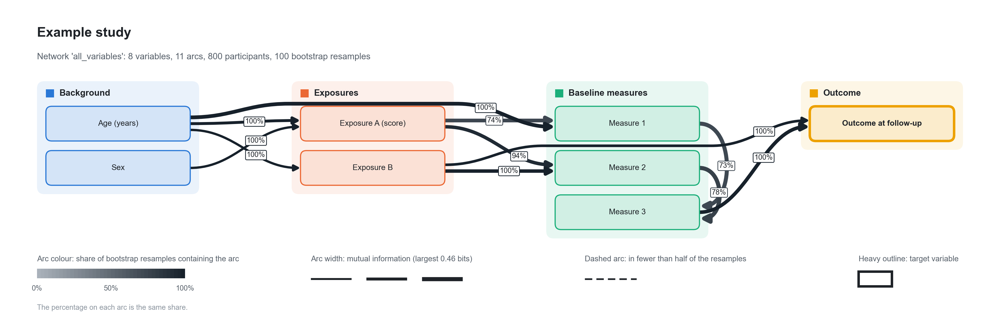

<p align="center">
  <picture>
    <source media="(prefers-color-scheme: dark)" srcset="docs/assets/logo-dark.svg">
    
  </picture>
</p>

<p align="center">
  <a href="https://doi.org/10.5281/zenodo.22028618"></a>
  <a href="https://umcu.github.io/layerbn/"></a>
  <a href="https://github.com/umcu/layerbn/actions/workflows/ci.yml"></a>
  
  <a href="LICENSE"></a>
</p>

`layerbn` learns a Bayesian network from cohort data in which **you decide the order of the
variables**. You place them in ordered layers, for example background, exposures, baseline
measures, outcome, and an arc may only run to the same layer or a later one. The data decide
which of the permitted arcs are present, how stable each one is under resampling, and how
much each variable tells you about the outcome. You describe the study in a spreadsheet and
a short settings file; no code needed.

<p align="center">
  
</p>

<sub>Example output on simulated data. Layers are the coloured bands, in causal order. Arc
width is the mutual information between two variables; arc colour and the percentage on each
arc give the share of bootstrap resamples that contain it.</sub>

## Quick start

Requires Python 3.11 or newer.

```bash
pip install "layerbn @ git+https://github.com/umcu/layerbn@v3.0.0"
layerbn init my-study          # a project folder with a worked example
layerbn run my-study --fast    # about 20 seconds
```

Then open `my-study/results/report.html`: every figure and table, a note on how to read each,
a methods paragraph, and an interactive explorer of the network.

## Documentation

**[umcu.github.io/layerbn](https://umcu.github.io/layerbn/)**

| | |
| --- | --- |
| [Start here](docs/start/first-run.md) | Install, and a tour of the worked example. |
| [Your own study](docs/guide/index.md) | Six steps from a data table to a report you can publish. |
| [Reading the results](docs/results/index.md) | What each figure and number means, and what it does not. |
| [Reference](docs/reference/index.md) | Every column, setting, command and function. |
| [Error messages](docs/help/troubleshooting.md) | What a message means and what to change. |

Coming from version 2? `layerbn migrate spec.yml` converts the old file; see
[upgrading](docs/about/upgrading.md).

The network shows associations supported by the data in the order you assumed. It is not an
estimate of causal effects.

## Development

```bash
git clone https://github.com/umcu/layerbn
cd layerbn
pip install -e ".[dev,notebook,docs]"

pytest                  # the whole suite, about a minute
pytest -m "not slow"    # skip the end-to-end runs
ruff check layerbn tests
mkdocs serve            # the documentation at http://127.0.0.1:8000
python docs/assets/build_logo.py   # redraw the logo
```

## Citation and licence

Released under the [MIT licence](LICENSE). Citation metadata is in
[CITATION.cff](CITATION.cff); see [citing layerbn](docs/about/citing.md). Version 1.2.1 and
earlier were released as `vcibayes`. The Zenodo concept DOI covers all versions under both
names.

Developed in the [Vascular Cognitive Impairment (VCI) research group](https://research.umcutrecht.nl/research-groups/vascular-cognitive-impairment-vci/)
at UMC Utrecht, department of Neurology and Neurosurgery, led by
[Malin Overmars, PhD](https://research.umcutrecht.nl/researchers/malin-overmars/).
Networks are fitted with [pyAgrum](https://pyagrum.gitlab.io/).
