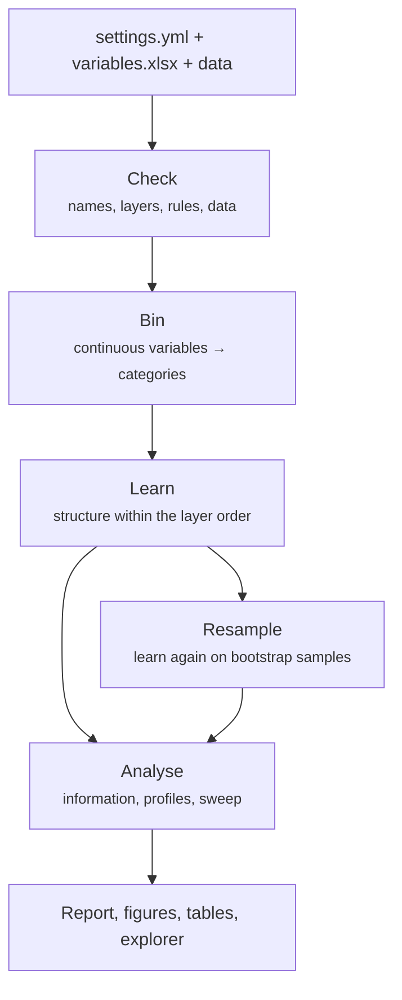

# How it works

What happens between `layerbn run` and the report, step by step.

## 1 · Check

The settings, the variables table and the data are read and checked against each other:
every name must exist, every layer must have variables, rules must not contradict each other
or the layer order, and the data must be complete. Problems stop the run with a message that
says what to change.

## 2 · Bin

Continuous variables are cut into bins (quantile by default, or your own cut points), and
categorical variables are used as they are. The bins are computed **once, from all data**,
and reused in every bootstrap resample, so that every resample describes the same
categories.

## 3 · Learn the structure

The network is learned by score-based search with [pyAgrum](https://pyagrum.gitlab.io/):

- **Score**: K2 (default), BDeu or BIC. For BIC, a small smoothing prior is added; K2 and
  BDeu carry their own.
- **Search**: tabu search (default) or greedy hill climbing.
- **At most** `max_parents` parents per variable.

**The layer order is enforced as a hard constraint.** Before the search, every arc that would
run from a later layer to an earlier one is forbidden, and so is every arc inside a layer with
`arcs_within: no`. Your `forbid` rules are added to that list, and `require`, `no_parents` and
`no_children` are passed to the learner as they are. The search can only choose among the
arcs that remain.

## 4 · Resample

The participants are drawn with replacement, `resamples` times, and the structure and the
probability tables are learned again on each sample, with the same bins and rules. Resample
`i` uses the seed `seed + i`, so a run is reproducible. The share of resamples that contain an
arc is its [stability](../results/stability.md).

## 5 · Analyse

On the network learned from all data:

- **Mutual information** of each arc and of each variable with each target, from exact
  inference in the fitted network, with each variable's relation to the target.
- **Profiles and sweeps**: the values are entered as evidence and the targets are read off,
  in every bootstrap network, giving a mean and a 2.5 to 97.5 percentile interval.

## 6 · Write

Figures (PNG and PDF), tables (CSV and one Excel file), each network (`.bifxml`, readable by
other Bayesian network software), the interactive explorer, a copy of the inputs with
checksums, and the report with a methods paragraph.

## Guarantees the tests check

The test suite runs on every change. Among other things it checks that:

- no learned network, and no bootstrap resample, contains an arc against the layer order;
- the structure of the simulated example is recovered;
- the same settings and seed give the same network and the same frequencies;
- the bin edges for the example have not moved with a dependency update;
- the explorer's in-browser inference agrees with pyAgrum;
- the command line works from `init` to `report.html`, from an installed package.
