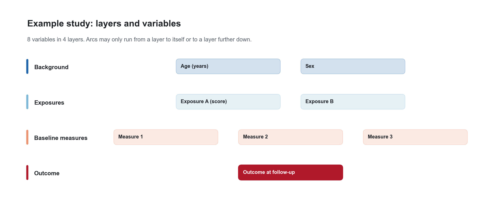

# 5 · Check and run

## Check

```bash
layerbn check my-study --figure
```

This reads the settings, the workbook and the data **without fitting anything**, and reports
problems in plain language: a layer spelt differently in two places, a variable that is not a
column of the data, missing values. It says what to change.

```text
Project      Example study
Variables    8 in 4 layers

Layers, in causal order (an arc may only run to the same layer or to a layer further down):
  1. Background
       Age (years); Sex
  2. Exposures
       Exposure A (score); Exposure B
  ...
Settings and design table are valid.

Data file demo_cohort.csv: 800 participants, all 8 variables found.
```

With `--figure` it also draws the layers to `results/figures/design.png`:

<figure markdown>

<figcaption>Arcs will run from the top down, from a layer to the same layer or a lower one. If a
variable is in the wrong place, change its layer or the order of the layers, and check
again.</figcaption>
</figure>

## Run

=== "1 · A trial"

    ```bash
    layerbn run my-study --fast
    ```

    20 resamples, to see that everything works. The report marks itself as a trial run, and
    its numbers are not for reporting.

=== "2 · The run you report"

    ```bash
    layerbn run my-study
    ```

    The number of resamples in `settings.yml`. It prints progress and an estimate of the time
    left.

Results go to `my-study/results/`. A new run **overwrites** them. To keep a result, copy the
folder or run with `--output results_v2`.

??? question "It takes too long"

    The time is almost all bootstrap, and grows in proportion to the number of resamples. Use
    `--fast` while setting up. `learning: search: greedy` is faster and searches less
    thoroughly. Fewer variables, bins and parents also help.

??? question "Something went wrong"

    The message says what and where. If it does not help, look it up under
    [Error messages](../help/troubleshooting.md).

[Next: report :material-arrow-right:](reporting.md){ .md-button .md-button--primary }
