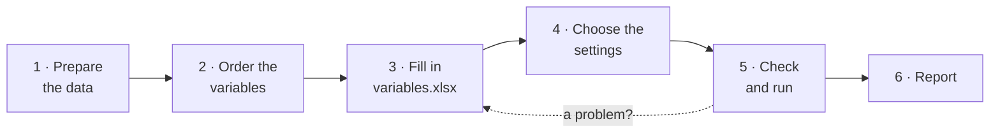

# Your own study

From your data table to a report you can publish, in six steps. Each step is a file you edit
or a command you type. If you have not yet [run the example](../start/first-run.md), do that
first: it takes ten minutes and shows you where everything goes.

## Before you start

- [ ] layerbn is [installed](../start/install.md) and `layerbn --help` works.
- [ ] Your data are in **one table**: one row per participant, one column per variable.
- [ ] You know, roughly, **which variables can influence which**. You will turn that into
      layers in step 2. Discussing it with a co-author first saves time.

## Create your project

Open a terminal, go to the folder where your analyses live, and create an empty project:

```bash
cd ~/Documents                    # Windows: cd $HOME\Documents
layerbn init my-cohort --blank
cd my-cohort
```

That gives you:

```
my-cohort/
├── settings.yml        HOW to analyse            → step 4
├── variables.xlsx      WHICH variables, in which layers   → steps 2 and 3
└── data/               your data file goes here  → step 1
```

Stay in this folder in the terminal: the commands in step 5 look for `settings.yml` in the
folder you are in.

## The six steps



| Step | You do | In | Time |
| --- | --- | --- | --- |
| [1 · Prepare the data](data.md) | Make one clean table and copy it to `data/` | your own software | depends on your data |
| [2 · Order the variables](layers.md) | Decide the layers and their order | discussion with co-authors | the main scientific choice |
| [3 · Fill in variables.xlsx](workbook.md) | One row per layer, one row per variable | Excel | 15 minutes |
| [4 · Choose the settings](settings.md) | Set the data file name; usually nothing else | text editor | 5 minutes |
| [5 · Check and run](check-run.md) | `layerbn check --figure`, then `layerbn run` | terminal | minutes to an hour |
| [6 · Report](reporting.md) | Read the report; write up | your manuscript | |

!!! tip "Going back and forth is normal"

    `layerbn check` tells you what does not match yet: a misspelt column, a layer name typed
    differently in two places, missing values. Fix it, check again. When it says the files are
    valid, you are ready to run.

## Going further

Once the basic analysis runs, these are optional:

<div class="grid cards" markdown>

-   [**Several networks**](networks.md): what changes when you leave out a layer.
-   [**Rules for arcs**](rules.md): forbid or require single arcs.
-   [**Profiles and sweeps**](profiles-sweeps.md): the outcome for groups you define.
-   [**Measurements over time**](repeated.md): the same variables at several visits.
-   [**The interactive explorer**](explorer.md): click through the network.
-   [**From Python**](python.md): the same analysis in a script or notebook.

</div>
