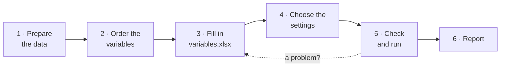

# Your own study

From your data table to a report you can publish, in six steps. Each step is a file you edit
or a command you type.

| Step | You work in | Time |
| --- | --- | --- |
| [1 · Prepare the data](data.md) | your own software | depends on your data |
| [2 · Order the variables](layers.md) | your head, and co-authors | the main scientific choice |
| [3 · Fill in variables.xlsx](workbook.md) | Excel | 15 minutes |
| [4 · Choose the settings](settings.md) | a text editor | 5 minutes |
| [5 · Check and run](check-run.md) | the terminal | minutes to an hour |
| [6 · Report](reporting.md) | your manuscript | |

!!! tip "Start from the example"

    If you have not done so, [run the example](../start/first-run.md) first. Its two files are
    the best template for your own.

## Going further

Once the basic analysis runs, these are optional:

-   [**Several networks**](networks.md): what changes when you leave out a layer.
-   [**Rules for arcs**](rules.md): forbid or require single arcs.
-   [**Profiles and sweeps**](profiles-sweeps.md): the outcome for groups you define.
-   [**Measurements over time**](repeated.md): the same variables at several visits.
-   [**The interactive explorer**](explorer.md): click through the network.
-   [**From Python**](python.md): the same analysis in a script or notebook.

