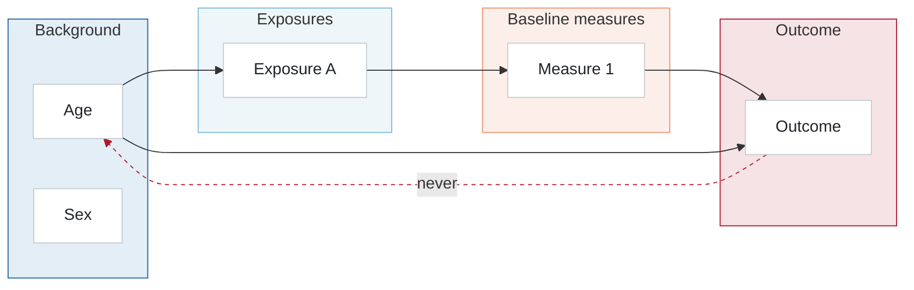

# 2 · Order the variables

This is the main scientific choice, and the only one layerbn cannot make for you.

A **layer** is a group of variables at the same stage of the order of influence. The layers
are put in order, and an arc may only run **within a layer or to a later layer**, never back.
The data decide which of the allowed arcs are present.

!!! warning "The order is an assumption"

    Every arc in the result is conditional on it. State it in your methods and be ready to
    defend it. If the order is wrong for some pair of variables, the result is wrong for that
    pair, and the data cannot tell you.

## Questions that help

Put a variable in a later layer than another if the other can influence it, but not the
other way around.

-   :material-clock-outline: **Time**

    Something measured later cannot cause something measured earlier. Baseline before
    follow-up, always.

-   :material-account-outline: **Fixed characteristics first**

    Age and sex are not caused by anything else in the study.

-   :material-flag-checkered: **Outcomes last**

    Exposures before outcomes. The outcome belongs in the last layer.

-   :material-equal: **Measured at the same moment?**

    Decide which can influence which, or put them in one layer and accept that the direction
    is not known.

## The example

| Layer | Variables | Measured | Arcs inside |
| --- | --- | --- | --- |
| Background | age, sex | baseline | allowed |
| Exposures | exposure A, exposure B | baseline | allowed |
| Baseline measures | measure 1, measure 2, measure 3 | baseline | allowed |
| Outcome | outcome | follow-up | not allowed |

## Arcs inside a layer

Inside a layer the data decide whether two variables are connected, but often **cannot decide
the direction**: several directions describe the data equally well. Treat such a direction as
arbitrary, unless you have a reason from outside the data.

To rule out arcs inside a layer, set `arcs_within` to `no` for it. That suits items of one
questionnaire, or a layer of outcomes that should not be shown as causing each other.

!!! failure "Do not move a variable later because you expect it to matter"

    The order says what *can* influence what. It says nothing about which variable is
    important. That is what the analysis finds out.

[Next: fill in variables.xlsx :material-arrow-right:](workbook.md){ .md-button .md-button--primary }
