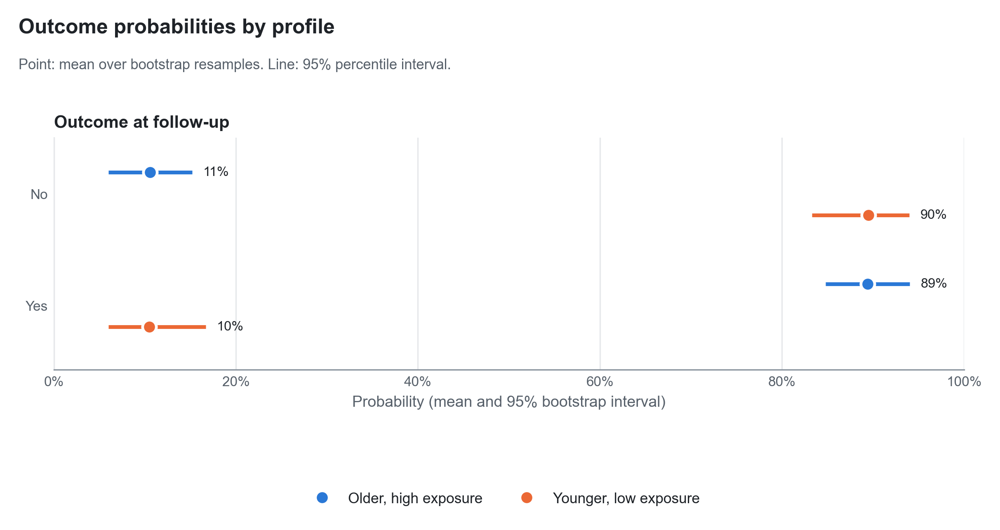
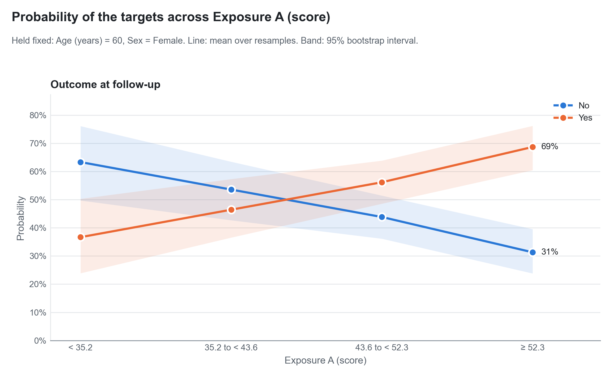

# Profiles and sweeps

Both read the probability of the targets from the network for people with certain values,
with a bootstrap interval. Set them up in the `analyses` block of `settings.yml`.

## Profiles

Groups you define by some of their values:

```yaml
analyses:
  profiles:
    network: all_variables
    targets: [OUTCOME]
    groups:
      "Younger, low exposure":
        AGE: 50
        EXPOSURE_A: 30
        EXPOSURE_B: "No"
      "Older, high exposure":
        AGE: 70
        EXPOSURE_A: 60
        EXPOSURE_B: "Yes"
```

<figure markdown>

</figure>

A number is placed in the bin that contains it, and the report says which bin that was.
`AGE: 50` means *the bin that contains 50*. A category is matched by name, and a bin can be
written as in the bins table (`"≥ 66.7"`).

## Sweeps

One variable moved across all its states, while others are held fixed:

```yaml
  sweep:
    network: all_variables
    variable: EXPOSURE_A
    fixed:
      AGE: 60
      SEX: Female
    targets: [OUTCOME]
```

<figure markdown>

</figure>

!!! warning "Hold fixed only what comes before"

    Fix only variables that come *before* the moved variable in the layer order. A fixed
    variable between the moved variable and the target blocks the path and flattens the
    curve. The run notes it when this happens.

How to read both: [Profiles and sweeps](../results/profiles-sweeps.md).
