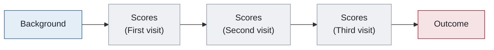

# Measurements over time

**Most studies do not need this page.** Variables measured at baseline go in earlier layers
and the outcome at follow-up in a later one, as in the example.

This page is for studies in which the **same variables were measured at several time
points**, for example a score at a first, second and third visit. You can then list each
variable once and the time points once, instead of every copy.

## In the data

One column per variable and time point, with the time point as a suffix:

| AGE | SCORE_T0 | SCORE_T1 | SCORE_T2 | OUTCOME |
| --- | --- | --- | --- | --- |
| 63.2 | 41.0 | 43.5 | 40.2 | No |

If your columns are named the other way around (`T0_SCORE`), set
`data: column_pattern: "{time}_{variable}"` in `settings.yml`.

## In variables.xlsx

=== "layers"

    Mark the layer as `repeated`:

    | layer | repeated |
    | --- | --- |
    | Background | no |
    | Scores | yes |
    | Outcome | no |

=== "variables"

    List the variable once, without the time point:

    | variable | layer | times |
    | --- | --- | --- |
    | AGE | Background | |
    | SCORE | Scores | |
    | OUTCOME | Outcome | |

    `times` limits a variable to some time points, such as `T0; T2`. Empty means all.

=== "timepoints"

    One row per time point, in time order:

    | time | label |
    | --- | --- |
    | T0 | First visit |
    | T1 | Second visit |
    | T2 | Third visit |

## What layerbn makes of it

The repeated layer is expanded into one layer per time point, in time order:

If several layers are repeated, they must follow each other on the `layers` sheet. They are
expanded together, one block per time point. In the figures each repeated variable keeps the
same row at every time point.

In `settings.yml`, `Scores` stands for the layer at every time point, and
`Scores (Second visit)` for one of them.

## Reading the result

- **Arcs between the same variable at consecutive time points** are usually stable and large.
  They show persistence, and are not a finding in themselves.
- **Arcs that skip a time point** mean the earlier value adds something beyond the one in
  between. They can reflect measurement error in the intermediate value.
- **Order within a time point** is an assumption, as between layers. If you do not hold it,
  put the variables in one layer.

!!! info "What it does not model"

    The network describes the joint distribution of the variables at the time points. It does
    not model trajectories, change scores, measurement error or latent variables. Every
    participant needs every variable at every time point.
