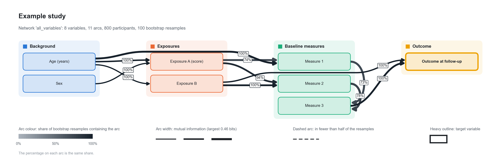
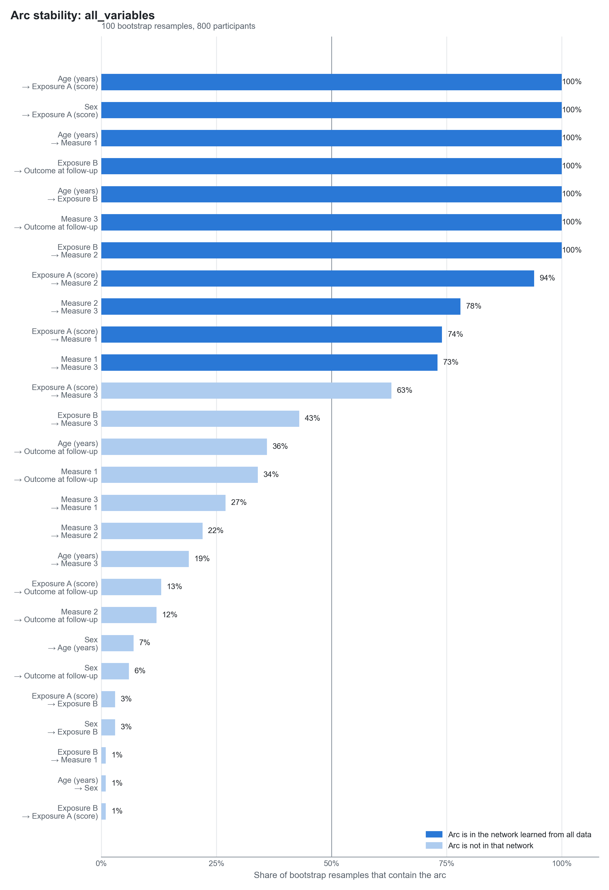
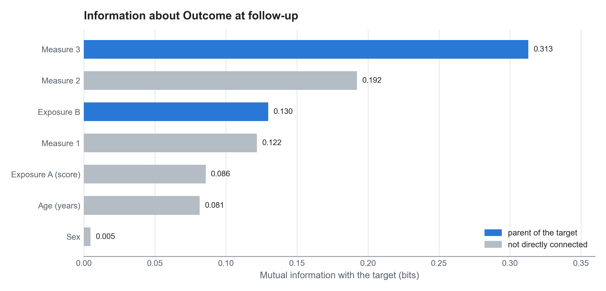
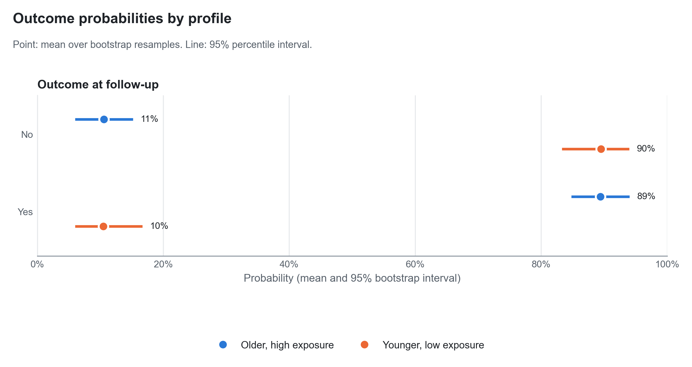
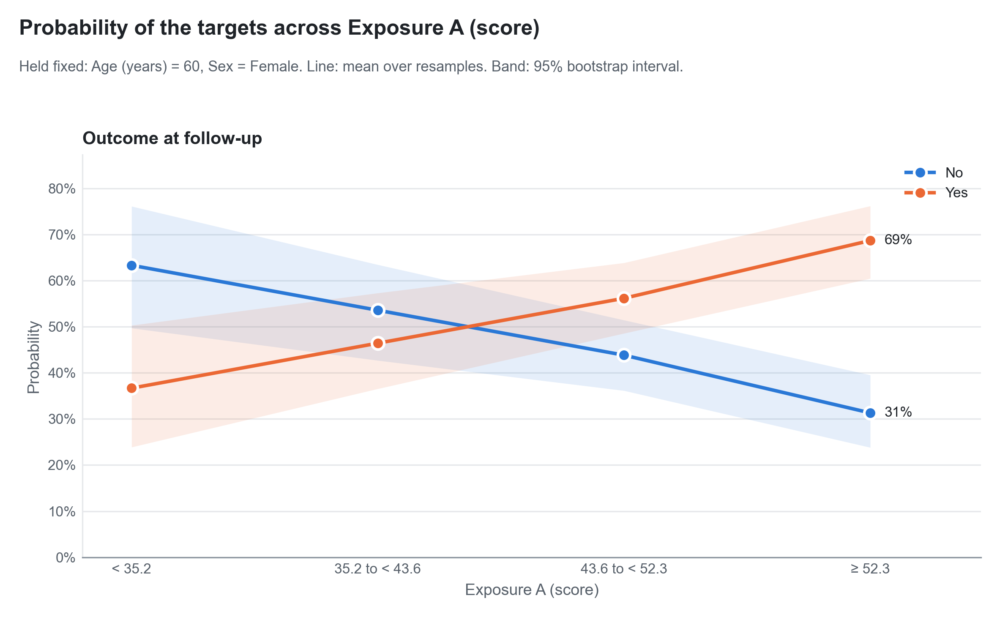
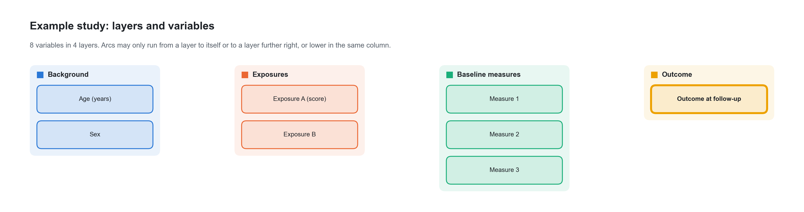

<div class="lb-hero" markdown>
<div markdown>


# Bayesian networks that follow the order of your study

<p class="lb-hero__lead">You decide which variables can influence which, by placing them in
ordered layers. The data decide which of the permitted arcs are there, how stable each one
is, and how much each variable tells you about the outcome. You describe the study in a
spreadsheet. No code needed.</p>

[Start in five minutes](start/first-run.md){ .md-button .md-button--primary }
[Open an example report](generated/example-report.html){ .md-button target="_blank" }

</div>
<div class="lb-hero__figure" markdown>



</div>
</div>

<h2 class="lb-section-title">Why fix the order?</h2>

<div class="lb-isnot" markdown>
<div markdown>

#### With layers

You place the variables in layers, for example background, exposures, baseline measures,
outcome. An arc may only run **to the same layer or a later one**. Your assumptions are
written down before the data are touched, and you can report them in the methods.

</div>
<div markdown>

#### Without

Unconstrained structure learning infers the direction of every arc from the data alone. It
can return an arc from an outcome at follow-up **back to age at baseline**. The direction then
reflects the algorithm, not anything you know about the study.

</div>
</div>

<h2 class="lb-section-title">Order, learn, read</h2>
<p class="lb-section-sub">Every analysis has the same three steps.</p>

<div class="lb-steps" markdown>
<div class="lb-step" markdown>

### Order

List your variables in <span class="lb-file">variables.xlsx</span> and put the layers in
causal order. Dropdown lists prevent typing mistakes.

[How to order variables →](guide/layers.md)

</div>
<div class="lb-step" markdown>

### Learn

`layerbn run` learns the network within your order and repeats this on bootstrap resamples
to measure how stable each arc is.

[Check and run →](guide/check-run.md)

</div>
<div class="lb-step" markdown>

### Read

One `report.html` with every figure and table, a note on how to read each, a methods
paragraph, and an interactive explorer.

[Reading the results →](results/index.md)

</div>
</div>

<h2 class="lb-section-title">What one run gives you</h2>
<p class="lb-section-sub">Figures as PNG and as PDF with editable text, tables as CSV and Excel,
all brought together in one self-contained report.</p>

<div class="grid cards lb-gallery" markdown>

-   

    **The network.** Layers as bands, arc width for information, arc colour and label for
    stability. [Read it →](results/network-figure.md)

-   

    **Arc stability.** How often each arc returns when the participants are resampled.
    [Read it →](results/stability.md)

-   

    **Information about a target.** Which variables tell most about the outcome, and how they
    connect to it. [Read it →](results/information.md)

-   

    **Profiles.** The probability of the outcome for groups you define, with bootstrap
    intervals. [Read it →](results/profiles-sweeps.md)

-   

    **Sweep.** How the outcome changes as one variable moves across its range.
    [Read it →](results/profiles-sweeps.md#sweeps)

-   

    **The design.** Your layers drawn before anything is fitted, to check the order.
    [Check it →](guide/check-run.md)

</div>

<div class="lb-try" markdown>

## Try it on simulated data

```bash
pip install "layerbn @ git+https://github.com/umcu/layerbn@v3.0.0"
layerbn init my-study          # a project with a worked example
layerbn run my-study --fast    # about 20 seconds
```

Then open `my-study/results/report.html`, or try the
[interactive explorer](guide/explorer.md) right here in the documentation.

</div>

<h2 class="lb-section-title">Where to go from here</h2>

<div class="grid cards lb-paths" markdown>

-   :material-rocket-launch-outline:{ .lg } **New to layerbn**

    Install it and walk through the worked example.

    [Start here](start/index.md)

-   :material-table-edit:{ .lg } **Ready for your own data**

    Six steps from a data table to a report you can publish.

    [Your own study](guide/index.md)

-   :material-chart-timeline-variant:{ .lg } **Looking at results**

    What each figure and number means, and what it does not.

    [Reading the results](results/index.md)

-   :material-book-open-variant:{ .lg } **Looking something up**

    Every column, setting, command and function.

    [Reference](reference/index.md)

</div>

!!! note "What the arcs are"

    The network shows associations supported by the data, arranged in the order you
    assumed. It is not an estimate of causal effects. See
    [what the network says](results/index.md).

<small>Developed in the Vascular Cognitive Impairment research group at UMC Utrecht. Networks
are fitted with [pyAgrum](https://pyagrum.gitlab.io/). Released under the MIT licence.
[How to cite](about/citing.md).</small>
