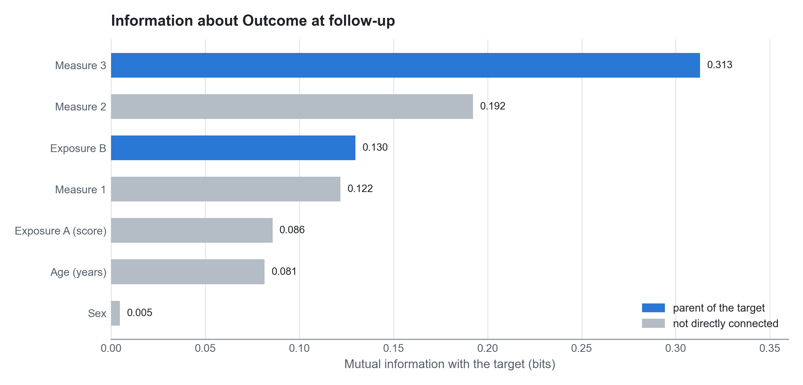

# Information about a target

**Mutual information** (MI) is how much knowing one variable reduces the uncertainty about
another, in bits, in the distribution of the fitted network. It is zero when they are
independent in the network and grows with the strength of the dependence. It is symmetric.

<figure markdown>

<figcaption>Every variable ranked by its mutual information with the outcome. The colour gives
its relation to the outcome in the learned structure.</figcaption>
</figure>

## Relation to the target

MI includes information that reaches the target **through other variables**, so a variable
can have a high MI without being connected to the target. The table therefore also gives
each variable's place relative to the target, and the number of arcs between them:

| Relation | Means |
| --- | --- |
| `parent` | An arc runs from the variable into the target. |
| `child` | An arc runs from the target into the variable. |
| `co-parent` | The variable and the target are both parents of the same variable. |
| `other` | Not directly connected. |

A high MI with relation `other` says the variable is informative about the target, and that
the learned structure explains this through other variables.

!!! note "Neither MI nor the relation is an effect estimate"

??? info "Why not MI given the parents of the target?"

    In a Bayesian network every variable is independent of its non-descendants given its
    parents. That conditional MI is therefore exactly zero for every variable except
    descendants of the target, and describes the model rather than the data. It is not
    reported.
