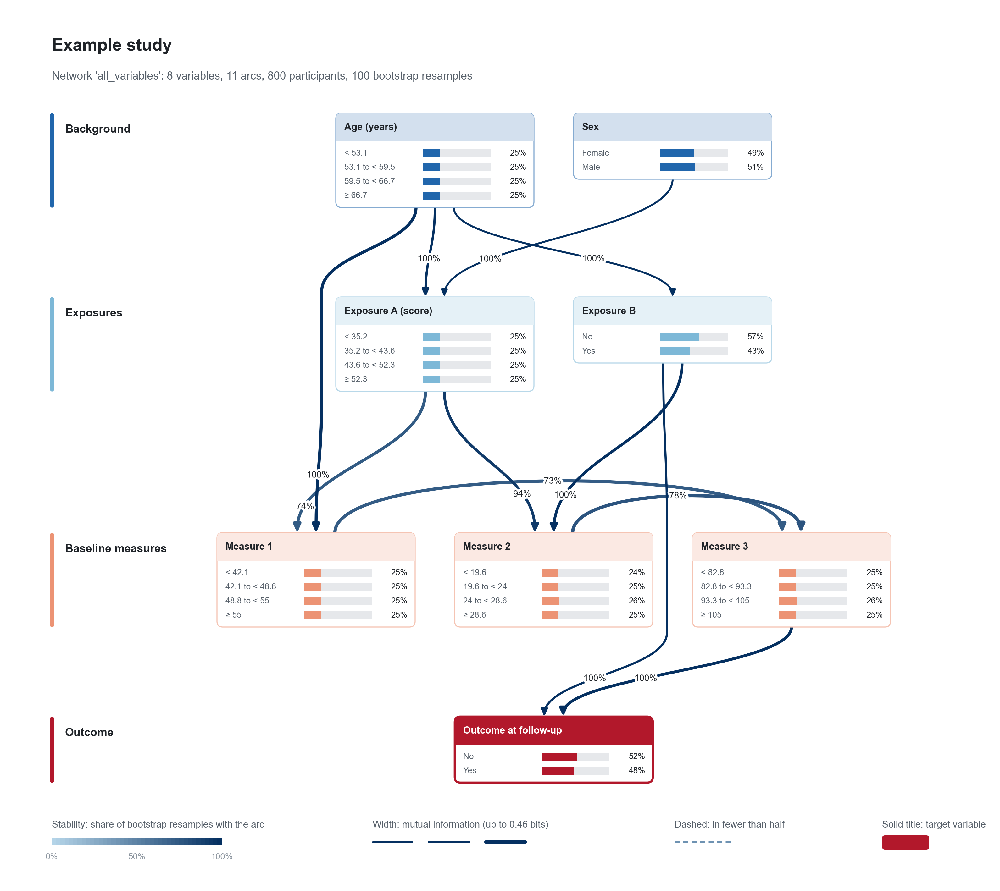

# The network figure

<figure markdown>

</figure>

Read it **from the top down**: the first layer is the top row, the outcome the bottom row. No
arc points upwards.

| Mark | Means |
| --- | --- |
| Row | A layer, named in the left margin. Rows are in causal order. |
| Layer **colour** | The layer's place in the order, along the RdBu palette: blue for the first layer, red for the last. |
| **Card** | A variable: its name, and its distribution in the fitted network as one bar per state, with the probability. |
| **Solid** title strip | A target. |
| Arc **width** | Mutual information between the two variables, in bits, in the fitted network. Square-root scale. The legend gives the largest. |
| Arc **darkness** | Darker: found in a larger share of the bootstrap resamples. |
| **Percentage** beside an arc | That share, as a number. Each sits on its own arc, clear of the variables and of the other percentages. |
| **Dashed** arc | Found in fewer than half of the resamples. |

Arcs that skip a layer are routed through the gaps between cards, so an arc never hides behind
one. Arcs inside a layer arch above its row. The arcs at one edge of a card are spread along it.

!!! note "The bars are the model's distribution"

    Each card shows the marginal distribution implied by the fitted network, not the counts in
    the data. For a variable with parents the two can differ slightly, because the probability
    tables are estimated with a prior. The bins figure in the report shows the data themselves.

## Width and darkness answer different questions

#### Wide and light

Much information in the fitted network, but **not stable**: another sample could have given
a different structure.

#### Narrow and dark

**Stable**, found in nearly every resample, but it carries little information.

Report both. The percentages are in `tables/arcs_<network>.csv`, with the mutual information
of every arc.

!!! tip "Focus on one variable"

    In Python, `figures.network_figure(study, highlight=["OUTCOME"])` fades every arc that
    does not touch the outcome. See [From Python](../guide/python.md).
