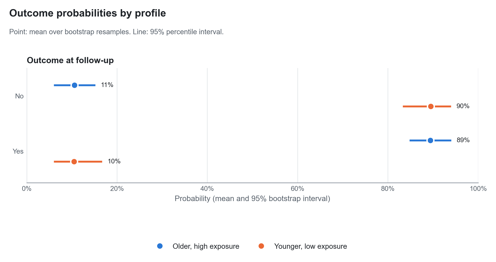
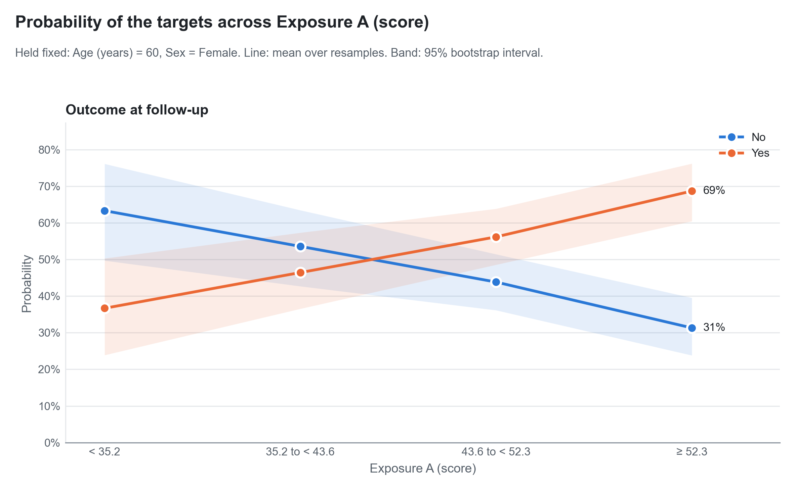

# Profiles and sweeps

## Profiles

A profile sets some variables to values and reads the probability of the targets from the
network. Variables outside the profile are **not fixed**: the network averages over them.
The result is a conditional probability in the learned model, for people who have these
values.

<figure markdown>

</figure>

- **The interval** runs from the 2.5th to the 97.5th percentile over the bootstrap resamples.
  Each resample learns structure and tables again, so the interval covers uncertainty about
  both. It is not a confidence interval for a causal effect.
- **Values are placed in bins.** `AGE: 50` means the bin that contains 50, and the report
  says which bin that was. If the bin is wide, the profile describes everyone in it.
- **Unusual combinations** can be supported by few or no participants. The network still
  returns a number, which then rests on the model more than on data.

## Sweeps

A sweep moves one variable across its states while the rest of the profile is fixed. It shows
how the probability of the targets differs **between people** who differ in that variable and
are alike on the fixed ones.

<figure markdown>

</figure>

!!! warning "Conditioning, not intervening"

    A sweep does not show what would happen if you changed the variable.

- **Fix only variables that come before** the moved variable in the layer order. A fixed
  variable between it and the target blocks the path and flattens the curve. The run notes
  this when it happens.
- **A flat curve with a narrow band is a result**: given the fixed values, the target does
  not depend on this variable in the model.
