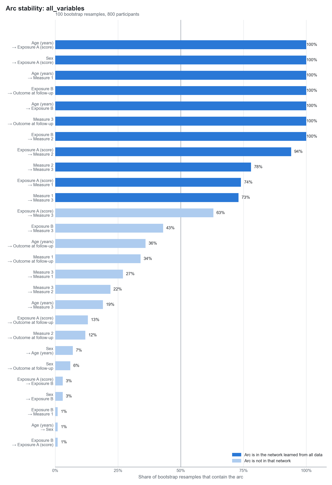

# Arc stability

The **stability** of an arc is the share of bootstrap resamples in which the learned network
contains it. In each resample, participants are drawn with replacement, and the structure and
the probability tables are learned again, with the same rules and the same bins.

<figure markdown>

<figcaption>Every arc found in any resample, with the share of resamples that contained it.
The colour of the bar says whether the arc is also in the network learned from all
data.</figcaption>
</figure>

#### It is

How sensitive the presence of an arc is to **which participants** happen to be in the
sample, under this learner and these settings.

#### It is not

- a p-value, or the probability that the arc is real;
- an effect size;
- independent of the settings: bins, score, maximum parents, search and sample size all
  change it.

!!! warning "There is no threshold"

    No frequency makes an arc "real". Report the frequency of every arc you discuss. Reporting
    only arcs above a cut-off hides how many were close to it.

## What moves the numbers

- **Alternatives split the stability.** If two correlated variables can each explain a third,
  each arc may appear in about half the resamples. Neither is then unimportant: the
  information is shared between them.
- **Strongly correlated variables**, such as two measurements of the same quantity, are
  almost always connected. That is expected, not a finding.
- **`In network` and `Frequency` are different questions.** One is the single network learned
  from all data, the other how often the arc returns. An arc can be in that network and
  return rarely, or the reverse. Report the frequency.
- **Failed fits** count as resamples without arcs, and the report says how many failed. Many
  failures mean the data are too thin for the settings.
- **The number of resamples** sets the precision. At 50%, the standard error is about
  5 percentage points with 100 resamples and about 11 with 20.
