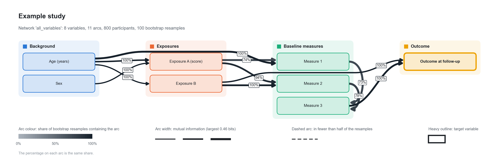

# Your first run

You will create a project with simulated data, analyse it, and look at the result. Keep this
example open later as a model for your own study.

## Create the example

```bash
layerbn init my-study
```

This creates a folder with three things in it:

```
my-study/
├── settings.yml        how to analyse
├── variables.xlsx      which variables, in which layers
└── data/
    └── demo_cohort.csv  800 simulated participants
```

The two files at the top are all you ever edit. You will see them again in
[Your own study](../guide/index.md).

## The example study

The example has the most common design: characteristics measured at baseline and an outcome
observed at follow-up. The names are general on purpose. Your own variables take their place.

| Layer | Variables | Measured |
| --- | --- | --- |
| Background | `AGE`, `SEX` | baseline |
| Exposures | `EXPOSURE_A` (a score), `EXPOSURE_B` (yes/no) | baseline |
| Baseline measures | `MEASURE_1`, `MEASURE_2`, `MEASURE_3` | baseline |
| Outcome | `OUTCOME` (yes/no), the target | follow-up |

The layers are in causal order, so an arc can run from Exposures to Outcome but never back.

!!! info "Simulated data"

    The data are generated from a known network, so you can see how well it is recovered.
    They describe no real person and support no scientific claim.

## Run it

```bash
layerbn run my-study --fast
```

It takes about 20 seconds and prints its progress. `--fast` uses 20 bootstrap resamples
instead of 100, which is enough to look around. The report marks itself as a trial run.

## Look at the result

Open `my-study/results/report.html` in a browser. It contains every figure and table, in
reading order, each with a short note on how to read it:

| Section | Shows |
| --- | --- |
| Design | The layers and variables, before anything was fitted |
| Data and bins | How each continuous variable was cut into bins |
| Network | The learned network, arc stability, and the information about each target, for each network |
| Profiles | The probability of the outcome for groups you defined |
| Sweep | How the outcome changes across one variable |
| Comparison of networks | Arc stability side by side, when you fit more than one network |
| Methods | A paragraph for your methods section, written from your settings |
| Reproducibility | Versions, seed and file checksums |

[Open a full example report](../generated/example-report.html){ .md-button target="_blank" }

<figure markdown>

<figcaption>The network of the example. Each band is a layer and every arc runs left to right.
The percentage on an arc is how often it was found across 100 bootstrap resamples.</figcaption>
</figure>

## Explore the network

Next to each network, the run writes an interactive page. Below is the one for this example.
**Click a state** of any variable, for example *Yes* under Exposure B, and every other
distribution updates. The grey tick marks the distribution before you clicked.

[:material-fullscreen: Open full screen](../generated/example-explorer.html){ .md-button target="_blank" }

<iframe class="lb-embed" src="../../generated/example-explorer.html" title="Interactive network explorer" loading="lazy"></iframe>

More in [The interactive explorer](../guide/explorer.md).

## What next

<div class="grid cards" markdown>

-   **Use your own data**

    [Your own study :material-arrow-right:](../guide/index.md)

-   **Understand the figures**

    [Reading the results :material-arrow-right:](../results/index.md)

</div>
